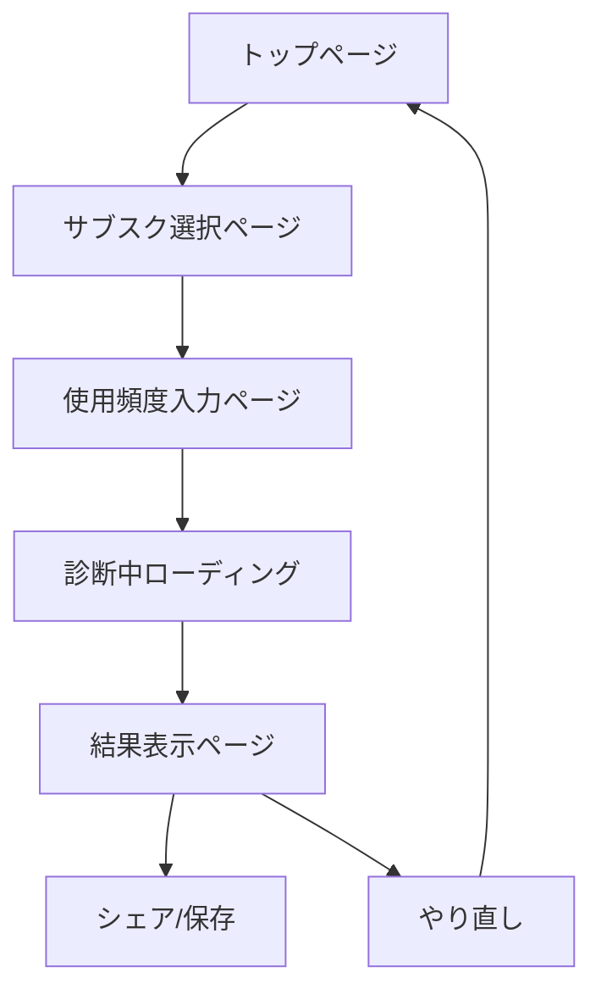

# SubCheck UI/UX設計

## 🎨 デザインテーマ

### カラーパレット

- **メイン**: ブルー系（#3B82F6 - 信頼感）
- **アクセント**: オレンジ/レッド系（#F59E0B, #EF4444 - 警告・気づき）
- **成功**: グリーン系（#10B981）
- **背景**: ホワイト/ライトグレー（#F9FAFB, #F3F4F6）
- **テキスト**: ダークグレー（#1F2937, #6B7280）

### トーン

- フレンドリーだけど少し「ドキッとさせる」
- 親しみやすく、分かりやすい
- 行動を促す（Call to Action）

### レスポンシブ

- モバイルファースト設計
- タブレット・デスクトップにも対応

## 📱 ページフロー



## 🏠 トップページ

### キャッチコピー

**メイン**: 「そのサブスク、本当に使ってる？」
**サブ**: 「無駄な出費を3分で診断」

### 構成要素

1. **ヒーローセクション**
   - キャッチコピー
   - 診断開始ボタン（CTA）
   - ヒーロー画像（サブスクアイコン群）

2. **サービス説明**
   - 3つの特徴（簡単・正確・即効果）
   - 利用者の声（想定）

3. **診断の流れ**
   - 3ステップの説明
   - 所要時間（約3分）

### UI要素

- **診断開始ボタン**: 大きく目立つ（#3B82F6）
- **アニメーション**: 軽やかな動き
- **アイコン**: 各サブスクのロゴ

## 📋 サブスク選択ページ

### レイアウト

- **進捗バー**: ステップ1/3
- **カテゴリタブ**: 横スクロール可能
- **サブスクカード**: グリッドレイアウト

### カテゴリ分類

1. **動画配信** (🎬)
2. **音楽** (🎵)
3. **ゲーム** (🎮)
4. **ニュース・雑誌** (📰)
5. **その他** (⚙️)

### サブスクカード

```
┌─────────────────┐
│   [ロゴ]        │
│   サービス名     │
│   ¥1,000/月     │
│   [ ✓ ] 選択     │
└─────────────────┘
```

### 「その他」入力

- **サービス名**: テキスト入力
- **月額料金**: 数値入力
- **追加ボタン**: リストに追加

## ⏱️ 使用頻度入力ページ

### レイアウト

- **進捗バー**: ステップ2/3
- **選択済みサブスク**: リスト表示
- **頻度選択**: ラジオボタン or カード選択

### 頻度選択UI

```
[サブスクA]
┌─────┐ ┌─────┐ ┌─────┐ ┌─────┐
│ 📅  │ │ 📆  │ │ 📌  │ │ ❌  │
│毎日 │ │週1-2│ │月1-2│ │未使用│
└─────┘ └─────┘ └─────┘ └─────┘
```

### インタラクション

- **選択時**: カードがハイライト
- **進捗**: 選択済み項目数を表示
- **次へボタン**: 全項目選択後に有効化

## 📊 診断結果ページ

### レイアウト構成

#### 1. メイン結果

```
┌─────────────────────────┐
│     【無駄率: 45%】      │
│                        │
│      [円グラフ]         │
│                        │
│  年間浪費額: ¥36,000    │
│  = 国内旅行1回分！      │
└─────────────────────────┘
```

#### 2. 詳細内訳

- **使用頻度別**: 棒グラフ
- **カテゴリ別**: 円グラフ
- **月額合計**: 数値表示

#### 3. アクション提案

```
┌─────────────────────────┐
│ 🔥 解約推奨サブスク      │
│                        │
│ • Netflix (¥1,490/月)   │
│   → 年間¥17,880節約    │
│                        │
│ • Adobe CC (¥6,480/月)  │
│   → 年間¥77,760節約    │
└─────────────────────────┘
```

### キャッチコピー

**メイン**: 「現実を見よう。でも大丈夫、今から変えられる。」

## 📱 モバイル対応

### ブレークポイント

- **スマートフォン**: 375px - 767px
- **タブレット**: 768px - 1023px
- **デスクトップ**: 1024px以上

### モバイル最適化

- **タッチターゲット**: 44px以上
- **フォントサイズ**: 16px以上（iOS）
- **横スクロール**: カテゴリ・サブスク選択
- **スティッキーヘッダー**: 進捗バー

## 🎭 アニメーション

### マイクロインタラクション

- **ボタンホバー**: 軽いスケール変化
- **カード選択**: バウンド効果
- **ローディング**: スピナー + カウントアップ

### ページ遷移

- **フェードイン**: 0.3秒
- **スライド**: 左右移動（ステップ進行）

## 🔗 関連ドキュメント

- [[01-requirements]] - 要件定義
- [[03-technical-architecture]] - 技術仕様
- [[design/wireframes]] - ワイヤーフレーム
