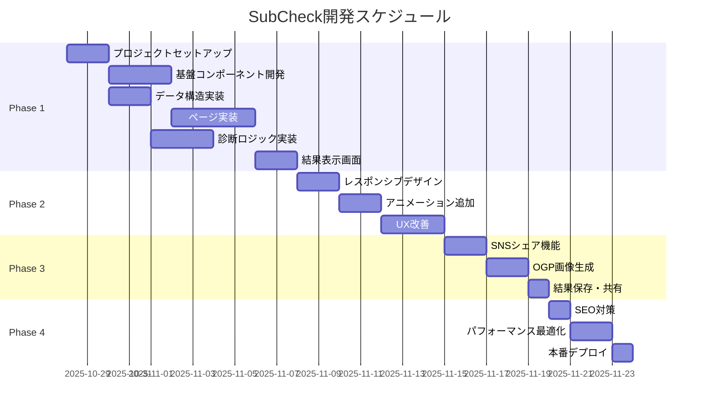

# SubCheck 開発計画

## 🎯 開発フェーズ

### Phase 1: MVP基盤構築（1-2週間）

**目標**: 基本的な診断機能の実装

#### Week 1

1. **プロジェクトセットアップ**
   - Next.js 14プロジェクト作成
   - TypeScript、Tailwind CSS設定
   - shadcn/ui導入
   - Rechartsライブラリ追加

2. **基盤コンポーネント開発**
   - レイアウトコンポーネント
   - 進捗バーコンポーネント
   - 基本UIコンポーネント

3. **データ構造実装**
   - TypeScript型定義
   - サブスクマスターデータ作成
   - ローカルストレージ管理

#### Week 2

4. **ページ実装**
   - トップページ（基本版）
   - サブスク選択画面
   - 使用頻度入力画面

5. **診断ロジック実装**
   - 診断計算アルゴリズム
   - 結果生成ロジック
   - おすすめアクション生成

6. **結果表示画面**
   - グラフ表示（Recharts）
   - 基本的な結果表示

### Phase 2: UI/UX改善（1週間）

**目標**: ユーザビリティ向上とレスポンシブ対応

7. **レスポンシブデザイン**
   - モバイル最適化
   - タブレット対応
   - デスクトップ調整

8. **アニメーション追加**
   - ページ遷移効果
   - マイクロインタラクション
   - ローディング画面

9. **UX改善**
   - エラーハンドリング
   - バリデーション
   - ユーザーフィードバック

### Phase 3: シェア機能実装（数日）

**目標**: SNS連携とバイラル機能

10. **SNSシェア機能**
    - Twitter/X シェア
    - LINE シェア
    - Facebook シェア

11. **OGP画像生成**
    - 動的画像生成（@vercel/og）
    - 結果サマリー画像
    - シェア最適化

12. **結果保存・共有**
    - ローカルストレージ保存
    - URL共有機能
    - 結果ID生成

### Phase 4: 公開準備（数日）

**目標**: 本番環境での安定運用

13. **SEO対策**
    - メタタグ最適化
    - 構造化データ
    - サイトマップ生成

14. **パフォーマンス最適化**
    - バンドルサイズ最適化
    - 画像最適化
    - キャッシュ戦略

15. **本番デプロイ**
    - Vercel設定
    - ドメイン設定
    - Analytics設定

## 📅 タイムライン



## 🛠 開発環境セットアップ

### 1. プロジェクト初期化

```bash
# Next.js プロジェクト作成
npx create-next-app@latest subcheck --typescript --tailwind --eslint --app --src-dir=false --import-alias="@/*"

# 追加パッケージインストール
npm install @radix-ui/react-icons lucide-react recharts framer-motion
npm install -D @types/node
```

### 2. shadcn/ui セットアップ

```bash
# shadcn/ui 初期化
npx shadcn-ui@latest init

# 必要コンポーネントのインストール
npx shadcn-ui@latest add button card progress badge dialog tabs radio-group checkbox input label
```

### 3. 開発ツール設定

```bash
# ESLint & Prettier 設定
npm install -D prettier eslint-config-prettier eslint-plugin-prettier

# Git hooks
npm install -D husky lint-staged
```

## 📂 実装優先順位

### 高優先度（Phase 1）

1. **サブスクマスターデータ** - 全機能の基盤
2. **診断ロジック** - コア機能
3. **基本UI** - ユーザー体験の土台
4. **ローカルストレージ** - データ永続化

### 中優先度（Phase 2-3）

5. **レスポンシブデザイン** - ユーザー層拡大
6. **SNSシェア** - バイラル効果
7. **アニメーション** - UX向上
8. **エラーハンドリング** - 安定性

### 低優先度（Phase 4+）

9. **高度なアニメーション** - 追加体験
10. **A/Bテスト機能** - 最適化
11. **多言語対応** - 国際化
12. **PWA対応** - アプリ体験

## 🧪 テスト戦略

### テスト種類

1. **単体テスト** - Jest + React Testing Library
2. **統合テスト** - Playwright（将来）
3. **E2Eテスト** - Cypress（将来）
4. **手動テスト** - デバイス・ブラウザ横断

### テスト優先順位

- **診断ロジック**: 最重要（計算の正確性）
- **ローカルストレージ**: 重要（データ永続化）
- **UI相互作用**: 中程度（ユーザー体験）

## 📊 品質管理

### コード品質

- **TypeScript strict mode** - 型安全性
- **ESLint + Prettier** - コード統一
- **Husky + lint-staged** - コミット前チェック

### パフォーマンス目標

- **Lighthouse Score**: 90点以上
- **First Contentful Paint**: 1.5秒以下
- **Largest Contentful Paint**: 2.5秒以下
- **Cumulative Layout Shift**: 0.1以下

### 継続的改善

- **ユーザーフィードバック収集**
- **Analytics監視**
- **A/Bテスト実施**
- **定期的なリファクタリング**

## 🚀 リリース戦略

### ソフトローンチ（内部テスト）

- 開発チーム内でのテスト
- 基本機能の動作確認
- 重大なバグの修正

### ベータリリース（限定公開）

- 友人・知人での限定テスト
- ユーザビリティテスト
- フィードバック収集・改善

### 正式リリース（一般公開）

- SNSでの告知
- プレスリリース
- インフルエンサー連携

## 🔄 継続開発計画

### Version 1.1（リリース後1ヶ月）

- ユーザーフィードバック対応
- バグ修正
- パフォーマンス改善

### Version 1.2（リリース後3ヶ月）

- 新機能追加
- サブスクデータ更新
- UI/UX改善

### Version 2.0（リリース後6ヶ月）

- 有料プレミアム機能
- 銀行連携（検討）
- 解約代行機能（検討）

## 🔗 関連ドキュメント

- [[00-project-overview]] - プロジェクト概要
- [[01-requirements]] - 要件定義
- [[02-user-interface]] - UI/UX設計
- [[03-technical-architecture]] - 技術仕様
